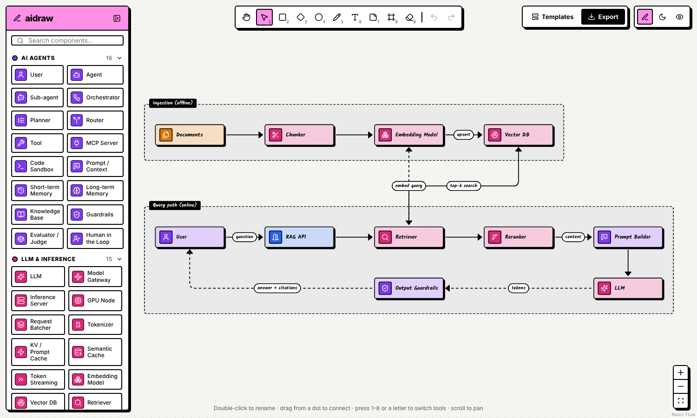

# aidraw

A whiteboard for system design diagrams. It works like Excalidraw or tldraw, but instead of plain
boxes the shapes are the building blocks of AI and infrastructure systems: agents, tools, MCP servers,
LLMs, vector databases, inference servers, feature stores, load balancers, queues, Kubernetes, and
AWS / GCP / Azure services.

Built for system design interviews, architecture reviews, and explainer videos.



## Getting started

You need [Node.js](https://nodejs.org) 18 or newer.

```bash
npm install
npm run dev
```

Open the URL it prints (usually http://localhost:5173).

| Command | What it does |
| --- | --- |
| `npm run dev` | Start the dev server with hot reload |
| `npm run build` | Type-check and build a static site into `dist/` |
| `npm run preview` | Serve the built site locally |

The app is entirely client-side, so `dist/` can be hosted on any static host (Vercel, Netlify,
GitHub Pages, Cloudflare Pages).

## Features

- **Component library** with search, grouped into:
  - **AI Agents** — agent, sub-agent, orchestrator, planner, router, tool, MCP server, memory, guardrails, evaluator, human in the loop
  - **LLM & Inference** — LLM, model gateway, inference server, GPU node, batcher, caches, embedding model, vector DB, retriever, reranker
  - **ML Systems** — data source, ETL, feature store, training job, experiment tracker, model registry, serving, drift monitor
  - **Distributed Systems** — clients, backend server, load balancer, API gateway, PostgreSQL, MySQL, MongoDB, Redis, queues, event streams, workers
  - **DevOps & Infra** — Kubernetes, containers, serverless, CI/CD, IaC, metrics, logs, tracing, secrets
  - **Cloud** — one section with AWS, GCP and Azure tabs
  - **Basic Shapes** — rectangle, ellipse, diamond, text, sticky note, group frame
- **Connectors** — drag from a dot on one shape to another. Each connector can have a label, solid /
  dashed / flowing (animated) lines, elbow / curved / straight routing, and arrowheads on one end,
  both, or neither.
- **Annotation** — freehand pen, text, sticky notes and an eraser.
- **Templates** — RAG pipeline, tool-using agent, LLM inference serving, ML training → serving.
- **Export** — PNG, SVG, or a `.aidraw.json` file you can reopen later.
- **Presentation mode** — hides the interface for screen recording (Esc to exit).
- **Undo / redo, duplicate, autosave** to the browser's local storage.
- **Light and dark** versions of the neo-brutalist theme, and a toggle for hand-drawn lettering.

## How to use it

- **Add a component** — drag it from the library, or click it to drop it in the centre.
- **Connect two shapes** — hover a shape and drag from one of its dots to another shape.
- **Rename anything** — double-click a label, a connector, or a frame title.
- **Restyle** — select a shape or connector and use the panel on the right.
- **Move around** — scroll to pan, ⌘/Ctrl + scroll to zoom, or hold Space and drag.

### Keyboard shortcuts

Tools use a number or a letter, as in Excalidraw.

| Tool | Keys | Tool | Keys |
| --- | --- | --- | --- |
| Select | 1 / V | Text | 6 / T |
| Rectangle | 2 / R | Sticky note | 7 / N |
| Diamond | 3 / D | Group frame | 8 / F |
| Ellipse | 4 / O | Eraser | 0 / E |
| Draw | 5 / P | Hand (pan) | H or hold Space |

| Action | Keys |
| --- | --- |
| Undo / redo | ⌘/Ctrl + Z / ⌘/Ctrl + Shift + Z |
| Duplicate selection | ⌘/Ctrl + D |
| Select all | ⌘/Ctrl + A |
| Delete selection | Delete or Backspace |
| Back to Select, exit presentation mode | Esc |

## Project structure

```
src/
  library.ts    The component catalogue: categories, items, icons, colours
  templates.ts  Starter diagrams and connector styling
  nodes.tsx     How each shape and connector is drawn
  App.tsx       The editor: canvas, toolbar, library panel, properties, export
  styles.css    The theme (colours are CSS variables at the top of the file)
```

### Adding your own components

Every component is one row in `src/library.ts`:

```ts
['vector-db', 'Vector DB', Radar],   // [unique id, label, lucide-react icon]
```

Add a row to an existing category, or add a new `cat(...)` block with its own colour, and it appears
in the library. Passing `'aws'`, `'gcp'` or `'azure'` as the last argument of `cat(...)` puts the
category under that tab of the Cloud section.

### Adding a template

Templates in `src/templates.ts` place components on a grid by column and row and reference them by
id, so a new starter diagram is a short list of nodes and edges.

### Changing the theme

Colours, borders and shadows are CSS variables at the top of `src/styles.css`, with a second block
for dark mode.

## Known limitations

- Connectors always join two shapes; there is no free-floating arrow or line tool.
- Group frames are visual only — moving a frame does not move the shapes inside it.
- Diagrams are saved in the browser, so they do not sync between devices. Use Export → Save as file
  to move one.
- Cloud components use generic icons in each provider's colour, not the official AWS, GCP or Azure
  service icons.

## Tech stack

[Vite](https://vite.dev), [React](https://react.dev) and TypeScript, with
[React Flow](https://reactflow.dev) for the canvas, [lucide](https://lucide.dev) for icons and
[html-to-image](https://github.com/bubkoo/html-to-image) for export.
